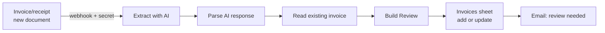

# How it works

*This page goes deep on purpose — it's the proof the homepage summary is real and tested, not just copy.
You don't need to follow all of it to use the result.*

## The flow

All the business rules live in one file, `extract.js`. `build.js` copies it into the workflow's Code nodes, so
the rules that are tested are the same ones that run. The actual vision extraction (reading the image) happens in
the **Extract with AI** node, calling Claude; everything after that is plain, testable logic.

## The math check

This is the trust layer: an invoice that "reads fine" but doesn't add up gets flagged instead of filed quietly.

| Check | Flag if it fails |
|---|---|
| Line items sum to the stated subtotal (± rounding) | `Line items sum to $X but subtotal says $Y` |
| Subtotal + tax equals the stated total (± rounding) | `Subtotal + tax ($X) doesn't match the total ($Y)` |

Rounding tolerance is 2 cents, to absorb normal currency rounding without flagging every invoice.

## Flags

| Flag | Meaning |
|---|---|
| `Missing: vendor name, total amount` | The AI couldn't read a required field — usually a poor photo |
| `No line items extracted` | Nothing legible in the line-item area; check the image quality |
| The two math-check flags above | The numbers the AI read don't add up |

A row is always written, flagged or not, so nothing silently disappears.

## When the same invoice comes in again

The workflow matches on the invoice number the AI extracted.

- **It updates the row** rather than creating a duplicate.
- **The Status is never overwritten** — an invoice marked `Approved` stays `Approved`, so a re-send (e.g. a
  clearer photo of the same invoice) doesn't undo a review that already happened.

## What's real and what's sample

- **Real:** the validation/math-check logic and its tests (`node extract.test.js`); the n8n workflow structure.
- **Sample:** every payload needs a real image/PDF URL and a working Anthropic credential to actually extract
  anything — the Node tests cover the logic layer by feeding it extraction results directly, the same way you'd
  mock any external AI/API call, not by running real images through the model.
- **One reviewer by default:** this sends every review to a single configured address. Per-vendor or
  per-amount routing is the same Settings-sheet pattern CloseLoop and FirstReply use, just not built in yet.

## Files

| File | What |
|---|---|
| `extract.js` | All rules: normalizing the AI's output, the math check, flags, review email |
| `extract.test.js` | Fixed-input checks for every rule (`node extract.test.js`) |
| `build.js` | Builds `workflow.json` with `extract.js` inlined into the Code nodes |
| `workflow.json` | Import into n8n (no credentials inside) |
| `payloads/`, `send-test.sh` | Sample intake payload and the script that sends it |

## Build status

| Part | State |
|---|---|
| Validation rules (math check, flags) | Built and tested, in Node and inside n8n |
| Workflow in n8n | Built, generic intake webhook → Claude vision call → Sheet → review email |
| AI extraction step | Wired to call Claude's API; not yet run against a real client invoice |
| Google Sheet end-to-end | Logic tested (`node extract.test.js`); not yet run against a live Sheet/Gmail |
| A real intake source (email/WhatsApp/Drive trigger) | Not built yet — depends on which the client actually uses |
